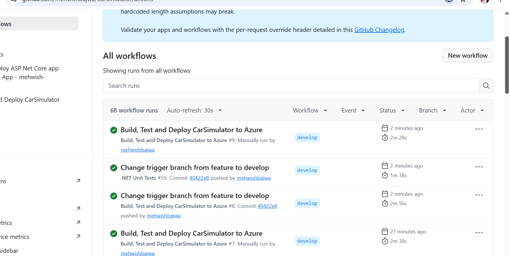

# CarSimulator – DevOps Project

## Project Overview

CarSimulator is an ASP.NET Core web application developed with C# and .NET 9. It simulates driving actions and displays direction, fuel level, energy level, and vehicle status.

The project demonstrates Git version control, Gitflow, automated unit testing, GitHub Actions CI/CD, Azure App Service deployment, and Azure infrastructure and security configuration.

**Repository:** [CarSimulator on GitHub](https://github.com/mehwishbajwa/CarSimulator)

**Working branch:** [develop](https://github.com/mehwishbajwa/CarSimulator/tree/develop)

**Live application:** [CarSimulator on Azure App Service](https://mehwish-carsimulator-acdnbwefemcsbpgc.francecentral-01.azurewebsites.net/)

## Technologies

- C# and .NET 9
- ASP.NET Core
- Git and GitHub
- GitHub Actions
- Automated .NET unit testing
- Microsoft Azure App Service
- Azure Resource Manager (ARM)
- Azure monitoring and logging
- Azure App Service IP restrictions
- Azure SQL firewall configuration

## Repository Structure

| Path | Description |
|---|---|
| `CarSimulatorApp.sln` | .NET solution |
| `CarSimulator.Server/` | ASP.NET Core web application |
| `DataLogicLibrary.Tests/` | Automated unit tests |
| `.github/workflows/azure-deploy.yml` | Build, test, publish, and deploy workflow |
| `docs/` | G1–G10 assessment documentation |
| `docs/images/` | Supporting screenshots and evidence |

## Prerequisites

- .NET 9 SDK
- Git
- Appropriate Azure permissions for deployment
- GitHub Actions repository secrets for Azure authentication

## Build and Test Locally

From the repository root, restore dependencies, build the solution, and run unit tests.

**Restore dependencies:**

`dotnet restore CarSimulatorApp.sln`

**Build the solution:**

`dotnet build CarSimulatorApp.sln --configuration Release --no-restore`

**Run automated unit tests:**

`dotnet test DataLogicLibrary.Tests/DataLogicLibrary.Tests.csproj --configuration Release`

**Run the web application locally:**

`dotnet run --project CarSimulator.Server/CarSimulator.Server.csproj`

The local application URL is displayed in the terminal when the application starts. Environment-specific configuration can be provided through application settings or environment variables.

## Branch Strategy (G2)

The project follows a Gitflow-inspired branching strategy.

- `main` – Main project branch.
- `develop` – Integration branch and automatic CI/CD deployment trigger.
- `feature/add-tests` – Unit test development.
- `feature/github-actions-tests` – Earlier GitHub Actions and Azure deployment configuration work.

Git commits and pull requests are used to track development changes.

See [G2 – Gitflow Documentation](docs/G2-Gitflow.md).

## Application Configuration (G3)

The application uses several approaches to manage configuration.

- `CarSimulator.Server/appsettings.json` contains general application settings.
- `CarSimulator.Server/appsettings.Development.json` contains development-specific settings.
- Environment variables can override application configuration.
- Azure App Service application settings allow configuration without modifying source code.
- GitHub Actions repository secrets store the Azure identity identifiers used by the deployment workflow.

Sensitive information, including passwords, authentication tokens, and database connection strings, should not be committed to the repository.

See [G3 – Application Configuration Documentation](docs/G3-Application-Configuration.md).

## Continuous Integration and Deployment (G5–G6)

The GitHub Actions workflow [`azure-deploy.yml`](.github/workflows/azure-deploy.yml) runs automatically when changes are pushed to `develop`. It also supports manual execution.

### CI/CD Pipeline Process

1. Check out the repository and configure the .NET 9 SDK.
2. Restore project dependencies.
3. Build the .NET solution in Release mode.
4. Execute automated unit tests from `DataLogicLibrary.Tests`.
5. Publish the `CarSimulator.Server` web application.
6. Upload the published application as a deployment artifact.
7. Authenticate to Azure using OpenID Connect (OIDC).
8. Deploy the published application to Azure App Service.

The deployment job depends on the successful completion of the build-and-test job. If the build or tests fail, deployment does not proceed.

### Verified CI/CD Results

GitHub Actions run **#8** was automatically triggered by a push to the `develop` branch and completed successfully.

Both jobs completed successfully:

- `build-and-test` – Successful.
- `deploy` – Successful.

A separate .NET unit testing workflow also completed successfully.

[View GitHub Actions Workflow Runs](https://github.com/mehwishbajwa/CarSimulator/actions)

### CI/CD Success Evidence

Additional documentation and evidence:

- [G5 – GitHub Actions Testing](docs/G5-GitHub-Actions-Testing.md)
- [G6 – Continuous Deployment](docs/G6-Continuous-Deployment.md)

## Azure Deployment (G4)

CarSimulator is deployed to Microsoft Azure App Service.

**Azure configuration:**

| Property | Value |
|---|---|
| Application name | `mehwish-carsimulator` |
| Resource group | `CarSimulator-RG` |
| Region | France Central |
| Runtime | .NET 9 |
| Operating system | Windows |
| Deployment platform | GitHub Actions |
| Deployment branch | `develop` |
| Authentication | Azure OIDC federated credentials |

**Live application:**

[Open CarSimulator on Azure](https://mehwish-carsimulator-acdnbwefemcsbpgc.francecentral-01.azurewebsites.net/)

The application uses an Azure-generated hostname containing a regional suffix. The shorter `mehwish-carsimulator.azurewebsites.net` address is not the confirmed application URL.

See [G4 – Azure Deployment Documentation](docs/G4-Azure-Deployment.md).

## Infrastructure, Security, and Monitoring (G7–G10)

The project includes documentation and evidence covering Azure infrastructure and security.

**G7 – Azure Resource Manager (ARM)**

Documents the Azure Resource Manager deployment process and related evidence.

**G8 – Monitoring and Logging**

Documents Azure monitoring and logging features used to observe the deployed application.

**G9 – IP Restrictions**

Documents Azure App Service access restrictions and their configuration.

**G10 – Azure SQL Firewall**

Documents Azure SQL firewall configuration and supporting evidence.

### Infrastructure Security

The project explores infrastructure security practices, including:

- Azure role-based access control.
- Azure managed identity and OIDC authentication.
- GitHub Actions secret management.
- Azure App Service IP restrictions.
- Azure SQL firewall rules.
- Monitoring and logging.

### Container Deployment

The current CarSimulator application is deployed directly to Azure App Service as a published .NET application, not as a container image.

Container-based deployment is a separate deployment approach in which an application and its dependencies are packaged into a container image and deployed through a container-compatible hosting service.

The documented Azure configurations demonstrate App Service deployment and infrastructure security without claiming that a container deployment has been implemented.

## DevOps Assignment – G1–G10 Evidence

| Requirement | Documentation |
|---|---|
| G1 – Version Comparison | [G1 Documentation](docs/G1-Version-Comparison.md) |
| G2 – Gitflow | [G2 Documentation](docs/G2-Gitflow.md) |
| G3 – Application Configuration | [G3 Documentation](docs/G3-Application-Configuration.md) |
| G4 – Azure Deployment | [G4 Documentation](docs/G4-Azure-Deployment.md) |
| G5 – GitHub Actions Testing | [G5 Documentation](docs/G5-GitHub-Actions-Testing.md) |
| G6 – Continuous Deployment | [G6 Documentation](docs/G6-Continuous-Deployment.md) |
| G7 – ARM Deployment | [G7 Documentation](docs/G7-arm-deployment.md) |
| G8 – Monitoring and Logging | [G8 Documentation](docs/G8-Monitoring-Logging.md) |
| G9 – IP Restrictions | [G9 Documentation](docs/G9-IP-Restriction.md) |
| G10 – Azure SQL Firewall | [G10 Documentation](docs/G10-Azure-SQL-Firewall.md) |

Supporting screenshots and evidence are stored in the [`docs/images/`](docs/images/) directory.

## Submission Notes

- The assignment is submitted using the `develop` branch, where the assessment documentation and successful CI/CD workflow are maintained.
- The repository must be accessible to the course assessor.
- The Azure application and relevant resources should remain available until grading is complete.
- No passwords, authentication tokens, or sensitive connection strings should be included in the submission.

**Repository for submission:** [CarSimulator – develop branch](https://github.com/mehwishbajwa/CarSimulator/tree/develop)
