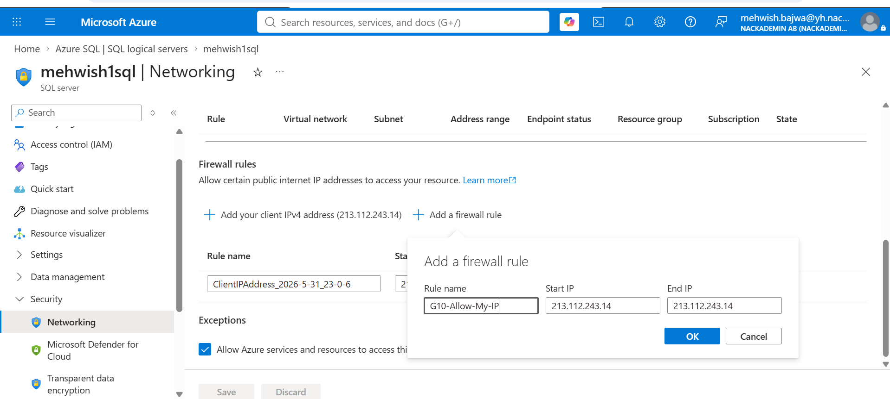
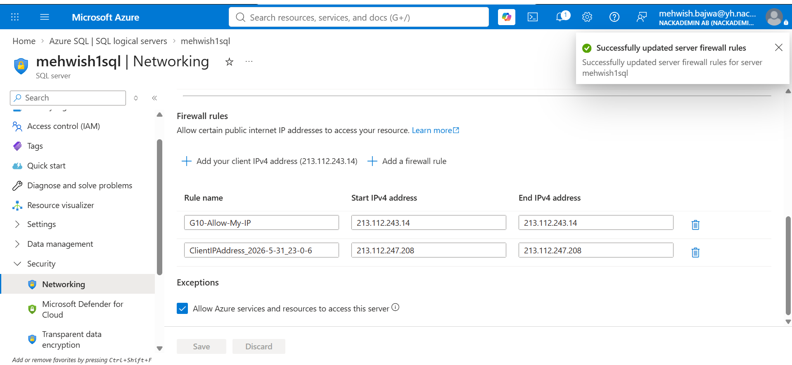

# G10 – Azure SQL Firewall Configuration

## Objective
Configure an Azure SQL firewall rule to allow access from a specific client IP address.

## Azure Resources
- SQL Server: `mehwish1sql`
- Database: `passwordChangeAPI`
- Resource Group: `rg-changepassword-api`

## Firewall Configuration
- Rule name: `G10-Allow-My-IP`
- Start IP: `213.112.243.14`
- End IP: `213.112.243.14`

## Evidence 1 – Firewall Rule

## Evidence 2 – Firewall Saved Successfully

## Result
The Azure SQL firewall rule was configured and saved successfully.
