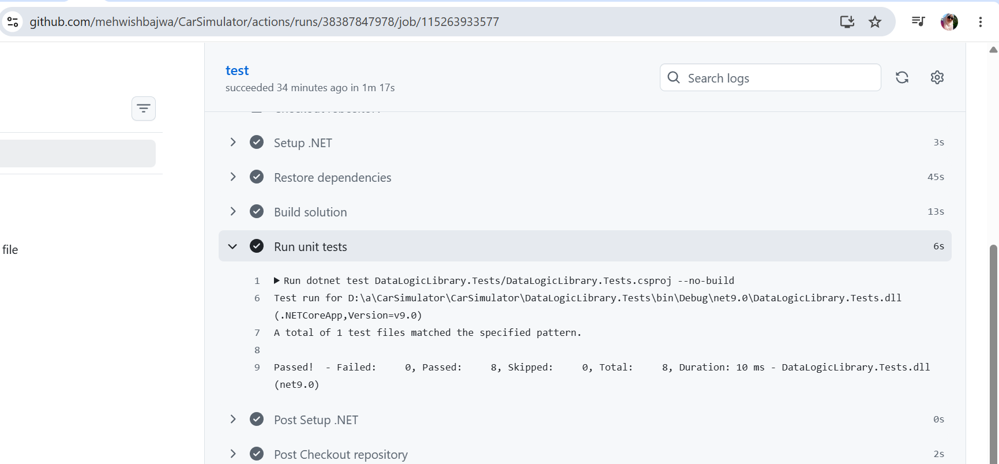

# GitHub Actions – Automated Unit Testing

## Objective

The objective is to automate the build and unit testing process for the CarSimulator application using GitHub Actions.

## Implementation

A GitHub Actions workflow was configured to perform the following tasks:

1. Check out the repository.
2. Set up .NET 9.
3. Restore project dependencies.
4. Build the CarSimulator solution.
5. Execute the unit tests using xUnit.

## Test Results

The GitHub Actions workflow executed successfully.

- Total tests: 8
- Passed: 8
- Failed: 0
- Skipped: 0

## Evidence

The following screenshot shows the successful GitHub Actions workflow and unit test results.

## Conclusion

GitHub Actions successfully automated the build and unit testing process. All eight unit tests passed, confirming that the tested simulation logic behaved as expected in this run.
