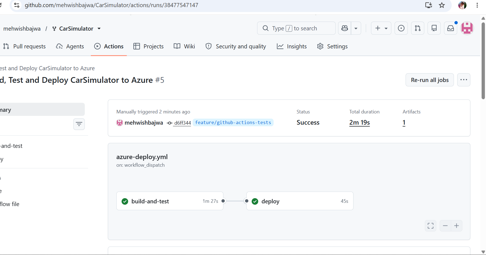

# G6 – Continuous Deployment and Test Automation

## Objective

The objective of G6 is to implement continuous deployment and automated testing using GitHub Actions and Microsoft Azure App Service.

## Implementation

I created a GitHub Actions workflow named `azure-deploy.yml` in the `.github/workflows` directory.

The workflow consists of two jobs:

**1. Build and Test**

- Checks out the repository.
- Sets up .NET 9.
- Restores project dependencies.
- Builds the solution in Release configuration.
- Runs automated unit tests.
- Publishes the ASP.NET Core web application.
- Uploads the published application as a deployment artifact.

**2. Deploy**

- Downloads the published application artifact.
- Authenticates with Microsoft Azure using GitHub Actions secrets.
- Deploys the application to Azure App Service.

The deployment job depends on the successful completion of the build-and-test job using `needs: build-and-test`. If the build or tests fail, the deployment job will not execute.

## Workflow Triggers

The workflow is configured to run automatically when changes are pushed to the `feature/github-actions-tests` branch. It can also be started manually using `workflow_dispatch`.

## Verification

I successfully executed the complete GitHub Actions pipeline.

**Results:**

- Overall workflow status: Success
- Build and Test: Success (1 minute 27 seconds)
- Deploy: Success (45 seconds)
- Total duration: 2 minutes 19 seconds
- Deployment target: Azure App Service (`mehwish-carsimulator`)

The successful run was manually triggered and verifies that the build, testing, and deployment jobs work together.

## Evidence

The screenshot below shows both jobs completing successfully.

[View successful GitHub Actions workflow run](https://github.com/mehwishbajwa/CarSimulator/actions/runs/38477547147)

## Conclusion

I implemented a GitHub Actions pipeline that builds, tests, and deploys my ASP.NET Core CarSimulator application to Microsoft Azure.

The pipeline uses automated testing as a quality gate before deployment, reducing the risk of deploying code that fails its tests.
