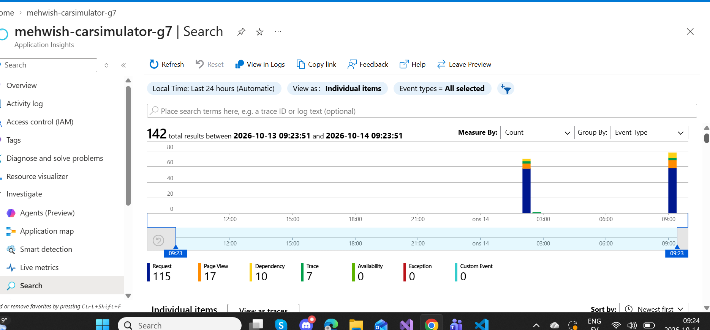
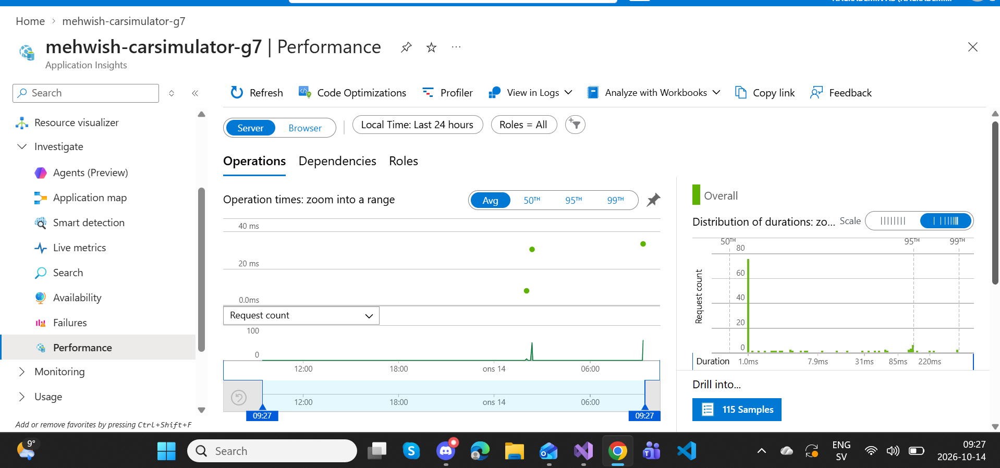
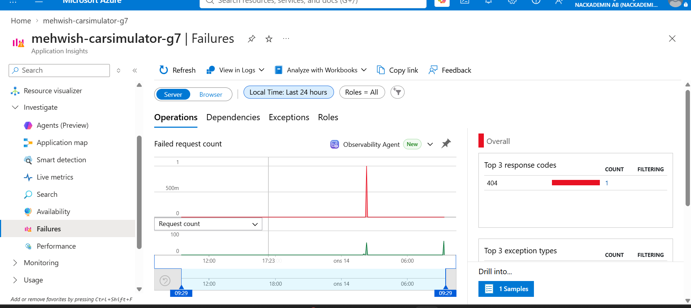
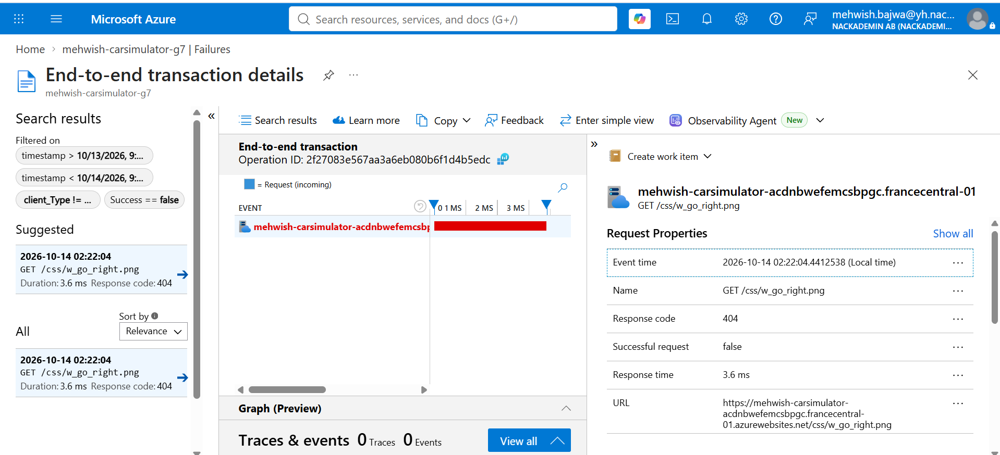

# G8 – Monitoring and Logging

## Objective

The purpose of G8 is to configure monitoring and logging for the CarSimulator application deployed to Microsoft Azure and demonstrate how monitoring tools can be used to analyze application performance, identify errors, and troubleshoot problems.

## 1. Azure Application Insights Configuration

I configured Azure Application Insights for my CarSimulator application hosted on Azure App Service.

The application is developed using ASP.NET Core and deployed to the France Central region.

Application Insights was enabled to collect application telemetry, including:

- HTTP requests
- Page views
- Application dependencies
- Application traces
- Failed requests
- Server response times

After applying the configuration, I verified that telemetry data was being collected.

## 2. Request Monitoring and Telemetry

I used the Search feature in Application Insights to examine the monitoring data generated by my deployed application.

During the selected 24-hour period, Application Insights displayed:

| Telemetry Type | Count |
|----------------|-------|
| HTTP Requests | 115 |
| Page Views | 17 |
| Dependencies | 10 |
| Traces | 7 |
| Total Events | 142 |

These results demonstrate that Application Insights is collecting telemetry from the deployed application.

### Evidence – Application Insights Telemetry

## 3. Application Performance Monitoring

I used the Performance section of Application Insights to monitor the response times and performance of my application.

The Performance dashboard provided information about:

- Server-side operations
- HTTP request durations
- Request counts
- Average response times
- Distribution of request durations

The dashboard displayed 115 request samples during the selected monitoring period.

This information can help identify slow requests and performance issues in the application.

### Evidence – Performance Monitoring

## 4. Failure Detection and Monitoring

I used the Failures section of Application Insights to investigate unsuccessful requests.

During the monitoring period, Application Insights identified one failed HTTP request with status code 404.

HTTP 404 means that the requested resource could not be found.

The Failures dashboard allowed me to examine the failed request and open its transaction details for further investigation.

### Evidence – Failure Detection

## 5. Troubleshooting Example – HTTP 404 Error

To demonstrate troubleshooting, I investigated the HTTP 404 error using the End-to-end transaction details feature in Application Insights.

### Error Details

| Property | Value |
|----------|-------|
| Application | CarSimulator |
| Request Method | GET |
| Requested Resource | /css/w_go_right.png |
| HTTP Status Code | 404 Not Found |
| Response Time | 3.6 ms |
| Environment | Production |
| Monitoring Tool | Azure Application Insights |

### Investigation

I followed these steps:

1. Opened Azure Application Insights.
2. Navigated to the Failures section.
3. Identified the failed HTTP request.
4. Selected the failed request sample.
5. Opened End-to-end transaction details.
6. Examined the request URL, response code, and response time.

The investigation showed that the application could not find the image `w_go_right.png` at the requested path.

### Possible Cause

The error may occur because:

- The image is missing from the deployed application.
- The image path is incorrect.
- The image was not included during deployment.
- The filename or directory does not match the requested URL.

### Suggested Solution

To resolve the issue, I would:

1. Check whether the image exists in the ASP.NET Core project's `wwwroot` directory.
2. Verify that the image path used by the application is correct.
3. Ensure that the image is included in the published application.
4. Redeploy the corrected application if necessary.
5. Use Application Insights to verify that the request no longer returns HTTP 404.

The issue was successfully identified and investigated. However, the correction has not yet been implemented and verified.

### Evidence – End-to-End Transaction Details

## 6. Monitoring and Logging Benefits

Using Azure Application Insights provides several benefits:

- Monitoring application activity in Azure
- Tracking incoming HTTP requests
- Identifying failed requests
- Investigating application performance
- Analyzing request durations
- Supporting troubleshooting in production
- Understanding application behavior through telemetry

These features help developers maintain and improve the reliability of deployed applications.

## 7. Conclusion

I successfully configured Azure Application Insights for my deployed CarSimulator application.

I verified that the application was collecting monitoring data, including HTTP requests, page views, dependencies, and traces.

I also used the Performance and Failures dashboards to analyze application behavior and investigate an HTTP 404 error.

The troubleshooting example demonstrated how Application Insights can be used to identify and investigate issues in an Azure-hosted ASP.NET Core application.

This completes the monitoring and logging demonstration for G8.
