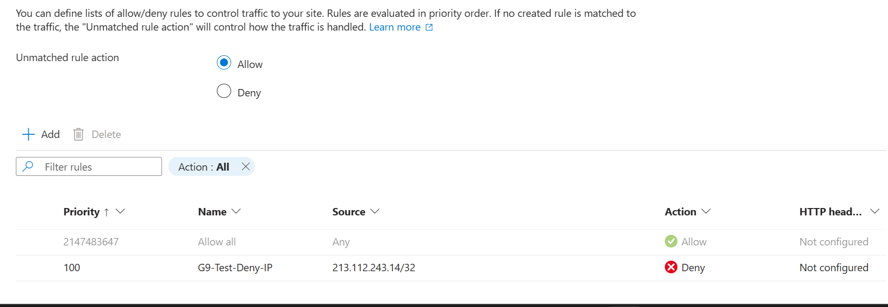
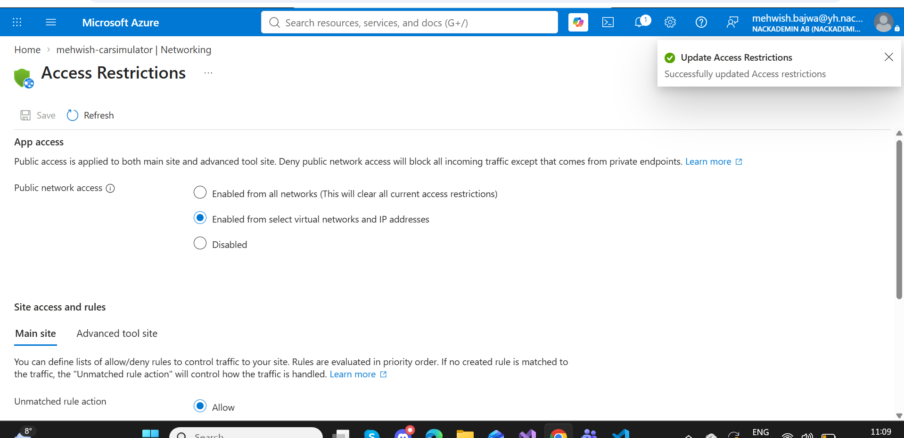
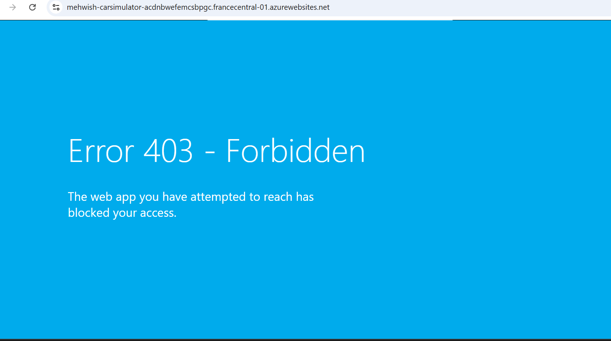
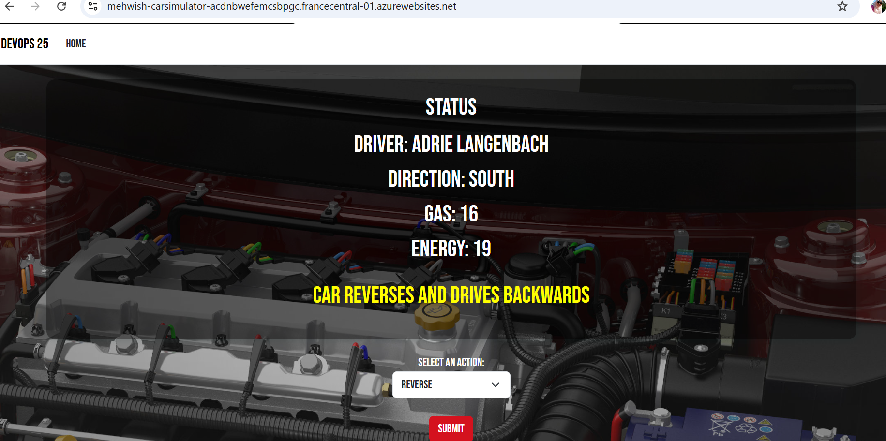

# G9 – IP Access Restrictions in Azure App Service

## 1. Objective

The objective of G9 is to configure IP-based access restrictions for a web application hosted in Microsoft Azure and verify that requests from a specified IP address can be blocked.

The CarSimulator web application was used for this assignment.

## 2. Environment

- Application: CarSimulator
- Azure Service: Azure App Service
- Web App: mehwish-carsimulator
- Resource Group: CarSimulator-RG
- Region: France Central
- Environment: Production
- Repository: CarSimulator
- Branch: develop

## 3. Configuring the IP Restriction

I opened the Azure Portal and navigated to:

App Service → mehwish-carsimulator → Networking → Access Restrictions

I configured a temporary IP restriction rule with the following settings:

| Setting | Value |
|---|---|
| Rule name | G9-Test-Deny-IP |
| Action | Deny |
| Priority | 100 |
| Source type | IPv4 |
| IP address block | 213.112.243.14/32 |
| Purpose | Temporarily block access from a specific IP address |

The `/32` CIDR notation specifies a single IPv4 address.

### Evidence – IP Restriction Rule

## 4. Saving the Configuration

After configuring the rule, I saved the access restrictions in Azure.

Azure displayed a confirmation that the access restrictions were successfully updated.

### Evidence – Configuration Saved

## 5. Testing the IP Restriction

To verify the configuration, I opened the deployed CarSimulator website from the restricted IP address.

The website returned:

**HTTP 403 – Forbidden**

The browser displayed the message:

"The web app you have attempted to reach has blocked your access."

This confirmed that the Azure App Service access restriction was functioning as expected.

### Evidence – HTTP 403 Forbidden

## 6. Restoring Website Access

After completing the test, I restored public access to the application by removing the temporary access restriction.

I then opened the deployed CarSimulator website again.

The application loaded successfully and displayed the car simulation interface.

This confirmed that normal website access had been restored.

### Evidence – Website Access Restored

## 7. Results

The following tasks were completed:

- Configured IP-based access restrictions in Azure App Service.
- Created a temporary deny rule for a specific IPv4 address.
- Saved the access restriction configuration.
- Verified blocked access through an HTTP 403 response.
- Removed the temporary restriction.
- Verified that the CarSimulator website was accessible again.
- Documented the process with screenshots.

## 8. Conclusion

G9 was completed successfully.

The exercise demonstrated how Azure App Service access restrictions can control incoming requests based on IP addresses.

The HTTP 403 response verified that the configured restriction blocked access. After removing the temporary restriction, the CarSimulator website became accessible again.

This provided practical experience in configuring, testing, and troubleshooting network access restrictions in Microsoft Azure.
